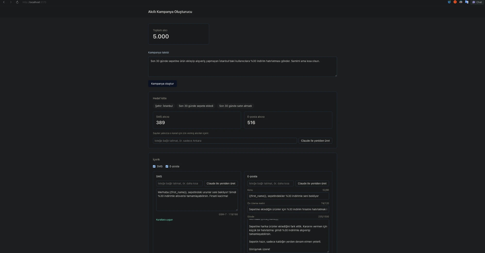
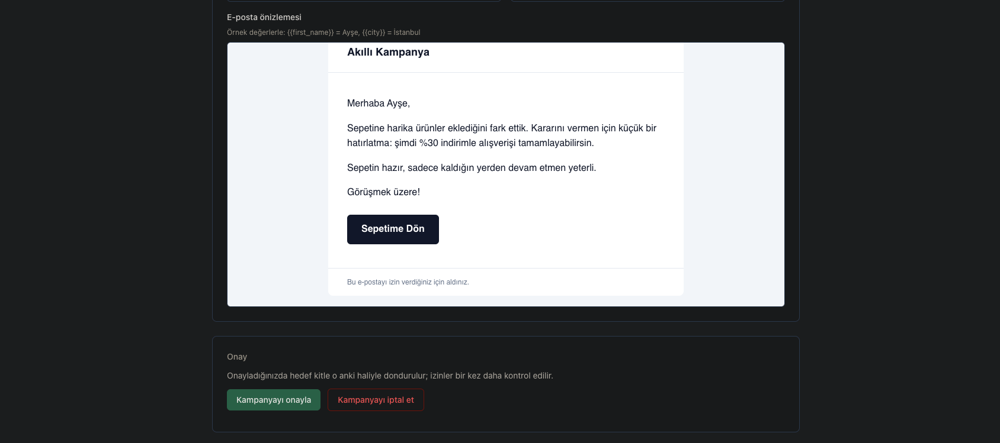

# Smart Campaign Composer

A Marketer writes a Brief in plain Turkish. Claude turns it into a Segment Rule and into SMS and email Content. The Marketer reviews, edits and approves the Campaign. A worker then sends it to a mock Provider through a rate-limited, retrying queue that does not send duplicates. A live dashboard shows the progress. Postgres is the only store and also the queue. No API key is needed to run it: without one, a scripted mock LLM answers.





The case is in [docs/case.md](docs/case.md). Domain terms (Brief, Segment Rule, Audience, Delivery, Attempt, …) are defined in [GLOSSARY.md](GLOSSARY.md). Decisions are indexed in [DECISIONS.md](DECISIONS.md).

## Quick start

You need Docker with Compose v2.

```sh
docker compose up --build    # UI on http://localhost:5173
make test                    # Go + Vitest suites, no API key needed
```

Optional: `cp .env.example .env` and set `ANTHROPIC_API_KEY` to use the real Claude.

- UI: http://localhost:5173
- API: http://localhost:8080 (`/healthz`, `/metrics`, `/api/...`)
- Postgres: `localhost:55432` (user, password and database are all `campaign`)

On first start the API runs the migrations and seeds about 5,000 Recipients and 50k Events. If a port is taken, set `WEB_PORT`, `API_PORT` or `POSTGRES_PORT` in `.env`. All ports bind to 127.0.0.1. `.env.example` documents every variable, including the mock Provider's failure rates and the worker's retry, lease and rate-limit settings.

## Try it

The seed is deterministic, but its timestamps are anchored to the day it runs ([ADR-0009](docs/adr/0009-seed-anchored-to-seed-day.md)). So the Audience counts below drift by a few Recipients from day to day. `docker compose down -v` re-seeds against today.

### 1. The example Brief

The UI placeholder is the case's example Brief. Paste it and click **Kampanya oluştur**:

> Son 30 günde sepetine ürün ekleyip alışveriş yapmayan İstanbul'daki kullanıcılara %30 indirim hatırlatması gönder. Samimi ama kısa olsun.

Expected:

- Segment Rule labels: "Şehir: İstanbul · Son 30 günde sepete ekledi · Son 30 günde satın almadı".
- Audience after consent: about 390 SMS and 515 email Recipients.
- The SMS streams in, then shows "GSM-7 · n/160" and "Kurallara uygun". Turkish letters are transliterated ([ADR-0002](docs/adr/0002-sms-gsm7-by-default.md)).
- The email has a subject, preheader and body, and a rendered preview with `{{first_name}}` = Ayşe and `{{city}}` = İstanbul.

Edit any Content field. It is re-validated as you type. Each part also has its own **Claude ile yeniden üret** button with an optional instruction. The mock LLM understands "daha kısa", "sadece Ankara", and "kadın"/"erkek".

### 2. A Brief the data cannot express

Recipients and Events have no product category. Try:

> Son ay ayakkabı alan Ankara'lılara yeni sezon duyurusu gönder.

**With `ANTHROPIC_API_KEY`.** Claude does not invent a field and does not drop the condition silently ([ADR-0007](docs/adr/0007-unsupported-criteria-warning.md)). The real-Claude run on 29 October 2026 gave:

- Warning, under "Şu ölçütler hedef kitleye uygulanamadı:": "ayakkabı ürün kategorisi (yalnızca ayakkabı alanlar ifade edilemiyor; herhangi bir alışveriş yapanlar kapsanıyor)"
- Segment Rule: "Şehir: Ankara · Son 30 günde satın aldı"
- Audience: 137 SMS / 178 email on that seed day
- Approved and sent: 137 SMS and 178 email sent, 0 failed

**Without a key.** The mock LLM is scripted for the example Brief only, so the UI shows "Mock LLM yalnızca örnek brief'i tanır; gerçek sonuç için ANTHROPIC_API_KEY girin." To see the warning with the mock, regenerate the Segment Rule with the instruction "sadece kadın". It comes back as "Cinsiyet: kadın".

The warning does not block approval. It is the Marketer's call.

### 3. Approve

Go back to the example Brief's Campaign and click **Kampanyayı onayla**. Approval freezes the Audience: one `deliveries` row per (Campaign, Recipient, Channel), with consent checked again in the same transaction. The dashboard then streams pending, sent, failed and cancelled counts per Channel.

### 4. Stop and start the worker mid-send

Sending runs at 100 requests per second per Channel, so it takes a few seconds. While the counts move:

```sh
docker compose stop worker
```

Sent stops growing. Wait a few seconds, then:

```sh
docker compose start worker
```

The worker reclaims leased Deliveries and finishes. A Delivery whose request was in flight is retried with the same `Idempotency-Key`, so the Provider replays its first answer instead of sending again. For a harder crash, use `docker compose kill -s SIGKILL worker`.

### 5. Prove there are no duplicates

Every accepted Attempt is a Provider acceptance. So, per Channel, the number of `sent` Deliveries must equal the number of Attempts with outcome `sent`:

```sh
docker compose exec postgres psql -U campaign campaign -c "
SELECT d.channel,
       count(DISTINCT d.id)                                      AS deliveries,
       count(DISTINCT d.id) FILTER (WHERE d.state = 'sent')      AS sent,
       count(DISTINCT d.id) FILTER (WHERE d.state = 'failed')    AS failed,
       count(a.id) FILTER (WHERE a.outcome = 'sent')             AS accepted_attempts
FROM deliveries d
LEFT JOIN attempts a ON a.delivery_id = d.id
WHERE d.campaign_id = (SELECT max(id) FROM campaigns WHERE approved_at IS NOT NULL)
GROUP BY d.channel ORDER BY d.channel;"
```

Expected (counts vary by seed day; `failed` is almost always 0):

```
 channel | deliveries | sent | failed | accepted_attempts
---------+------------+------+--------+-------------------
 email   |        515 |  515 |      0 |               515
 sms     |        390 |  390 |      0 |               390
```

`sent` equals `accepted_attempts` in every row. No Delivery was accepted twice:

```sh
docker compose exec postgres psql -U campaign campaign -c "
SELECT delivery_id, count(*) FROM attempts
WHERE outcome = 'sent' GROUP BY delivery_id HAVING count(*) > 1;"
```

Expected: `(0 rows)`.

To see the retries that the mock Provider's injected 429s, 5xx and timeouts caused:

```sh
docker compose exec postgres psql -U campaign campaign -c "
SELECT outcome, status_code, count(*) FROM attempts GROUP BY 1, 2 ORDER BY 1, 2;"
```

Expected (across all Campaigns, so the numbers grow with each send):

```
 outcome | status_code | count
---------+-------------+-------
 retry   |         429 |   145
 retry   |         503 |    60
 retry   |             |    51
 sent    |         202 |  1220
```

An empty status is a timeout or an Attempt cut off by the stopped worker.

`curl -s localhost:8080/metrics` shows the same sent, failed and retry counts per Channel.

## Where to look

Weights are from [docs/case.md](docs/case.md).

| Criterion | Code | Decisions | Tests |
|---|---|---|---|
| **LLM integration (25%)** | `backend/internal/llm/` (`claude.go`, `mock.go`, `llm.go`), `backend/internal/httpapi/repair.go`, `generation.go`, `regenerate.go`, `content.go` | [ADR-0005](docs/adr/0005-two-llm-calls-with-repair-loop.md) two calls + repair loop, [ADR-0003](docs/adr/0003-segment-rule-is-whitelisted-json-not-sql.md) JSON not SQL, [ADR-0007](docs/adr/0007-unsupported-criteria-warning.md) unsupported criteria, [ADR-0002](docs/adr/0002-sms-gsm7-by-default.md) GSM-7 | `llm/claude_test.go` (against a fake Messages API), `llm/mock_test.go`, `httpapi/repair_test.go`, `regenerate_test.go`, `content_test.go`, `generation_test.go` |
| **Architecture and decisions (20%)** | `docker-compose.yml`, `backend/cmd/`, `backend/internal/db/migrations/`, `backend/internal/segment/` | [DECISIONS.md](DECISIONS.md), [ADR-0001](docs/adr/0001-postgres-as-queue.md) Postgres as queue, [ADR-0004](docs/adr/0004-consent-outside-segment-rule.md) consent outside the rule, [ADR-0008](docs/adr/0008-one-content-per-channel.md) one Content per Channel, [ADR-0009](docs/adr/0009-seed-anchored-to-seed-day.md) seed day, [GLOSSARY.md](GLOSSARY.md) | `app/app_test.go`, `config/config_test.go`, `segment/audience_test.go` |
| **Backend reliability (20%)** | `backend/internal/worker/` (`worker.go`, `bucket.go`), `httpapi/approve.go`, `cancel.go`, `dashboard.go`, `metrics.go`, `backend/internal/provider/` | [ADR-0006](docs/adr/0006-idempotency-key-and-lease.md) idempotency key and lease | `httpapi/crash_test.go` (SIGKILL/SIGSTOP mid-send), `sending_test.go`, `retries_test.go`, `ratelimit_test.go`, `cancel_test.go`, `approve_test.go`, `approve_guards_test.go`, `worker/bucket_test.go`, `provider/provider_test.go` |
| **Frontend (20%)** | `web/src/components/` (`CampaignComposer`, `ContentReview`, `RegenerateControl`, `ApprovalPanel`, `CampaignDashboard`), `web/src/stores/`, `web/src/api.ts` | Q13, Q18, Q20 in [ai-sessions/00-initial-spec.md](ai-sessions/00-initial-spec.md) | `web/src/**/*.test.ts`, with the SSE fake in `web/src/testing/sse.ts` |
| **Tests and code quality (15%)** | `Makefile`, `.github/workflows/ci.yml`, `backend/internal/testenv/` | Q25 in [ai-sessions/00-initial-spec.md](ai-sessions/00-initial-spec.md) | `segment/segment_test.go` (whitelist, injection, consent override), `content/sms_test.go`, `content/partial_test.go`, `segment/labels_test.go` |

Go test paths are relative to `backend/internal/`.

### Testing

```sh
make test
```

This runs the Go tests (unit tests, plus integration tests against the compose Postgres, which it starts) and the Vitest suite for the frontend. No API key is needed: the Claude client is tested against a local fake of the Messages API. If Go is not installed on the host, the Go tests run in a container. The full run takes a few minutes, because the sending, rate-limit and crash tests run real workers against a mock Provider at 100 requests per second. CI runs `make test` on every push.

Notable suites:

- `backend/internal/segment`: the Segment Rule whitelist, the compiler, and the injection and consent-override tests.
- `backend/internal/content`: GSM-7/UCS-2 measurement, transliteration, and the limits checked against the longest name and city in the Audience.
- `backend/internal/httpapi/*_test.go`: the HTTP flow end to end. This includes the repair loop, approval guards, retries, rate limiting and cancel. `crash_test.go` SIGKILLs and SIGSTOPs worker processes mid-send and then checks for zero duplicates. `generation_test.go` SIGKILLs an api process mid-generation.

## Architecture

```
web (Vue 3, nginx) ──/api──▶ api (Go) ──▶ Claude / mock LLM
                               │
                               ▼
                           postgres  ◀── worker (Go) ──▶ provider (mock, Go)
```

- **Five containers.** `postgres`. `api` serves HTTP and SSE, makes the LLM calls, and runs the migrations and seed on startup. `worker` is the same Go binary in worker mode and sends Deliveries. `provider` is the mock SMS/email Provider. `web` is the built Vue app on nginx, which proxies `/api` to the API.
- **Postgres is the only store and also the queue** ([ADR-0001](docs/adr/0001-postgres-as-queue.md)). Approval freezes the Audience into one `deliveries` row per (Campaign, Recipient, Channel), with a unique constraint on that triple. The row holds the rendered payload. Consent is re-checked inside the approval transaction. Workers claim due rows with `FOR UPDATE SKIP LOCKED`.
- **Two LLM calls, each with a validate-and-repair loop** ([ADR-0005](docs/adr/0005-two-llm-calls-with-repair-loop.md)).
  - The first is a structured call for the Segment Rule. The rule is whitelisted JSON, never SQL. The backend validates it and compiles it to parameterized SQL ([ADR-0003](docs/adr/0003-segment-rule-is-whitelisted-json-not-sql.md)). Consent is applied outside the rule ([ADR-0004](docs/adr/0004-consent-outside-segment-rule.md)).
  - The second is a streamed call for the Content, forwarded to the browser over SSE as it arrives.
  - Both calls stream over SSE, so the UI shows a repair while it runs. If the output is malformed or breaks a rule, the errors go back to Claude, up to 2 times, before the Marketer sees an error.
  - SMS is held to one GSM-7 segment, measured with the longest real first name and city of the Audience substituted ([ADR-0002](docs/adr/0002-sms-gsm7-by-default.md)).
  - Approval is refused while a generation call runs. Each call registers itself and renews the registration every few seconds. A long call keeps blocking; one left by a crashed api expires within 15 seconds.
- **How duplicates are prevented** ([ADR-0006](docs/adr/0006-idempotency-key-and-lease.md)):
  - The unique constraint gives each Recipient exactly one Delivery per Campaign and Channel.
  - Every request carries `Idempotency-Key: <delivery id>`. A retry after a timeout replays the Provider's original acceptance instead of sending again.
  - A claim holds a lease. A crashed worker's Deliveries are reclaimed once the lease expires.
  - A result is written only if `attempt_count` still matches the claim, so a stalled worker cannot overwrite a newer outcome.
- **Sending.** 100 requests per second per Channel, enforced by a token bucket that halves its rate on bursts of 429s. 429s (honouring Retry-After), 5xx and timeouts are retried with exponential backoff and jitter, up to 5 Attempts. Other 4xx fail the Delivery at once. Every Attempt is logged in `attempts` with its status code, latency and error.
- **Cancelling.** Cancel stops new claims and moves every Delivery not yet handed to the Provider to `cancelled` ([ADR-0006](docs/adr/0006-idempotency-key-and-lease.md)). Deliveries in flight finish. One the Provider rejected is cancelled. One whose outcome is unknown (its request timed out, or its worker died) is retried with the same Idempotency-Key until the Provider says whether it was accepted. So the final counts are true.
- **Monitoring.** The dashboard is an SSE stream of pending, sent, failed and cancelled counts per Channel. `/metrics` serves Prometheus counters for sent, failed and retries per Channel. They are read from the database, so they cover every worker. `/healthz` pings the database.

### Mock LLM vs real Claude

- **`ANTHROPIC_API_KEY` empty (default):** a scripted mock LLM answers both calls and the UI shows a "Mock LLM" badge. It parses the city, the "son N gün" period and the cart/purchase intent from the Brief. It streams fixed, valid Content, so its Content does not follow the Brief closely. Extra whitespace and typographic quotes (’ “ ”, or quotes around the whole Brief) do not matter. Any Brief other than the example still gets a guessed proposal, with the "Mock LLM yalnızca örnek brief'i tanır" notice.
- **`ANTHROPIC_API_KEY` set:** the Segment and Content calls go to Claude. The model is `claude-sonnet-5-5` unless `ANTHROPIC_MODEL` overrides it. Restart the stack after changing either variable (`docker compose up -d`).

## How I worked with AI

All sessions are exported in [ai-sessions/](ai-sessions/), scrubbed of keys and personal data.

**The flow.** grill → spec → tickets → implement.

1. **Grill** ([00](ai-sessions/00-initial-spec.md)). Claude asked 26 design questions in rounds, each with a recommendation. The answers became [GLOSSARY.md](GLOSSARY.md) and the ADRs.
2. **Spec** ([01](ai-sessions/01-planning.md)). The decisions became one spec, published as a GitHub issue.
3. **Tickets** ([01](ai-sessions/01-planning.md)). The spec was split into 16 vertical-slice tickets, each a GitHub issue.
4. **Implement** ([02](ai-sessions/02-ticket-3.md)–[18](ai-sessions/18-ticket-17-readme-demo.md)). The first tickets were done one per session. The rest ran through `implement-spec` ([05](ai-sessions/05-spec-2-orchestrator.md)): an orchestrator ran at most 2 implementer subagents in parallel, committed per ticket and closed each issue.
5. **Review** ([19](ai-sessions/19-review-standards.md)–[21](ai-sessions/21-review-fixes.md)). A standards review and a spec review, then the fixes.

**Decisions I changed during grilling.**

- **SMS encoding (Q6 → Q9).** The first proposal (Q6) checked SMS length without looking at the encoding. I pointed out that ş, ğ and ı switch an SMS from GSM-7 to UCS-2, which drops the limit from 160 to 70. This became [ADR-0002](docs/adr/0002-sms-gsm7-by-default.md): GSM-7 by default, Turkish letters transliterated, length checked with the Audience's longest real name and city.
- **Q13 simplification.** The proposal let the Marketer edit Segment Rule labels directly. I cut that: Content is editable, the Segment Rule is shown as read-only labels with a "Claude ile yeniden üret" button, and label editing is deferred. I also simplified the dashboard (Q23).
- **Q17 objection.** The proposal keyed Content by (Channel, language, variant) from day one, to make room for per-language and A/B bonuses. I said no: one Content per Channel now, refactor if the bonuses happen ([ADR-0008](docs/adr/0008-one-content-per-channel.md)).
- **Moving the real Claude client earlier.** The ticket breakdown put the real Claude client near the end. I moved it right after the streamed-Content ticket, to test the streamed tool call against the real model early instead of finding problems at the end. I also added CI to the first ticket.

**What I verified by hand on 29 October 2026.** I ran the real Claude client with the example Brief and with a Brief containing an unsupported criterion (product category). Both gave a correct Segment Rule and Content. I approved that Campaign and stopped and restarted the worker mid-send. Result: 1220 Deliveries, exactly 1220 accepted Attempts, zero duplicates. Regeneration and repair prompts were not part of that run.

**Why the first two exports look different.** The desktop app has no `/export`. For sessions 00 and 01, I had Claude find the `.jsonl` transcripts on disk and write [scripts/transcript_to_md.py](scripts/transcript_to_md.py) to convert them to Markdown and redact secrets and personal data. Later sessions use the same script through the `export-session` skill (`.claude/skills/export-session/`).

## Known limitations and not built

**LLM**

- **The real model is checked by hand, not by the tests.** See the 29 October run above. `make test` uses a fake of the Messages API, so it needs no key. Sonnet thinks adaptively, so expect a pause before the first streamed token.
- **The mock LLM's Content is scripted.** It is valid and in Turkish, but generic. For example, a Brief that only names a city still gets cart-reminder Content.

**Sending**

- **The rate limit is per worker process.** Running several workers multiplies the 100/s. A distributed limiter was out of scope.
- **The Provider can accept a Delivery that is marked `failed`.** If the last allowed Attempt times out after the Provider accepted it, the Delivery is marked failed. Nothing is duplicated, but the dashboard under-reports sent messages.
- **A SIGKILLed worker's in-flight Attempt is never logged**, so `attempt_count` can exceed the number of Attempt rows. A graceful stop does log it.
- **A cancel can still send a Delivery that was in flight.** If its request timed out without reaching the Provider, the retry that finds out its outcome sends it. The alternative was to cancel it while it might already have been sent, which makes the final counts wrong.
- Lease expiry uses the database clock and the start window uses the worker's clock. Clock skew between the two hosts eats into the safety margin.

**Dependencies**

- **`npm audit` reports 3 open advisories in the frontend test runner** (2 critical in `tinypool`, 1 moderate in `@vitest/mocker`). All three come in through `vitest`, a dev dependency, and none reaches the production bundle. Vitest 3.x pins `tinypool@^1`, and both fixes ship only in Vitest 5, a major upgrade that was out of scope. The risk is limited to running the test suite locally or in CI. The rest (Vue, Vite) were fixed with in-range upgrades on 29 October 2026.

**Not built**

- Authentication. There is a single implicit Marketer.
- Per-language and A/B Content ([ADR-0008](docs/adr/0008-one-content-per-channel.md)).
- Brief criteria the Segment Rule cannot express. They are reported as warnings ([ADR-0007](docs/adr/0007-unsupported-criteria-warning.md)).
- Real SMS or email Providers.
- The case's bonus items (scheduled sending and so on).

## Repository layout

- `backend/`: the Go module. `cmd/campaign` is the API and worker, `cmd/provider` is the mock Provider, and the packages are under `internal/`.
- `web/`: the Vue 3, Vite, TypeScript, Pinia and Tailwind frontend.
- `docs/adr/`: the ADRs, indexed in `DECISIONS.md`.
- `docs/images/`: the screenshots above.
- `ai-sessions/`: the Claude Code session exports, scrubbed of keys and personal data.
- `scripts/transcript_to_md.py`: converts a session transcript to scrubbed Markdown.
